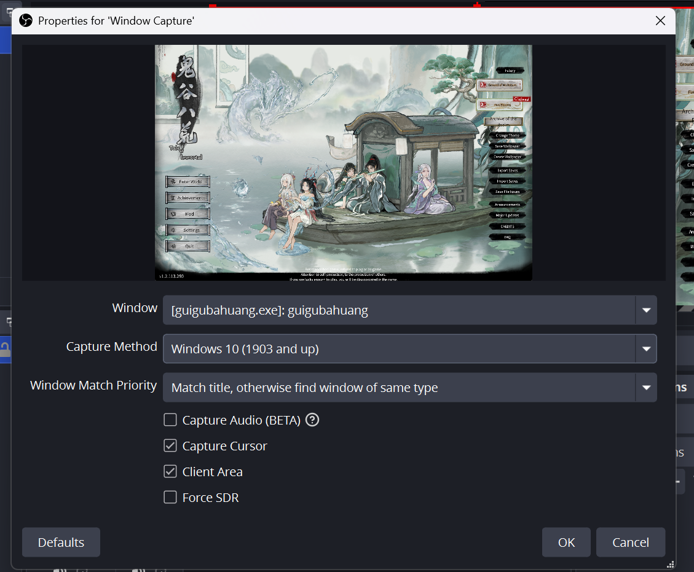

# DitLux M0 — Checklist Eksekusi

Dokumen kerja. Isinya **hanya** langkah, bukti selesai, dan apa yang tidak boleh dikerjakan dulu.
Penjelasan konsep (frame, swapchain, DWM, WGC, kenapa windowed) ada di `architecture.md`.

Bahasa & pustaka sudah diputuskan (§8): **Rust + crate `windows` (windows-rs)**, D3D11/DXGI/WGC. **Bukan wgpu.**

> **Status: PRASYARAT LULUS, UNIT R SELESAI.** Kamu sedang di **A.1**.
> Diperbarui 2026-10-13 setelah probe OBS dan verifikasi toolchain.

---

## 0. Cara memakai dokumen ini

1. **Satu unit = satu pertanyaan.** Jangan mengerjakan dua unit sekaligus, meskipun kelihatan mudah.
2. **Buktinya ya/tidak**, bukan "sepertinya jalan". Kalau buktinya belum kamu lihat sendiri, unit itu belum selesai.
3. **Gagal = berhenti dan catat** di §7, jangan lanjut. Unit berikutnya selalu bergantung pada yang sebelumnya.
4. **Jangan menambah apa pun yang tidak ada di daftar ini.** Godaan tercatat di §6.
5. Urutannya: **R (selesai) → Track A sampai A.5 → Track B.**

```
   R  reconnaissance tanpa koding                    [SELESAI]
   |
   +--- TRACK A: jalur keluar (game tidak perlu berjalan)
   |    A.1 window -> A.2 device -> A.3 swapchain -> A.4 ritme 60 Hz -> A.5 nol-alloc
   |                                                                    |
   |                            "datar 16,67 ms"  <-- gerbang ini dulu   |
   |                                                                    v
   +--- TRACK B: jalur masuk -------------------------------------> B.1 s/d B.9
        B.2 = paling berisiko -> isolasi, berhenti setelah tercetak
                                                                    |
                                                                    v
                                                        B.7 gambar ToI muncul di windowmu
                                                                    |
                                                                    v
                                                              syarat lulus §5
```

Kenapa Track A duluan: kalau ritme tayangmu belum terbukti datar, semua patah-patah di belakang
tidak bisa kamu tuding ke penyebab yang benar. Track A juga tidak butuh game berjalan.

---

## 1. Prasyarat — **LULUS 7/7**

Tabel ini sudah dikoreksi dari versi pertama. Dua syarat lama ternyata salah, dan penyebabnya
dicatat supaya tidak dipasang ulang.

| # | Kondisi | Kenapa | Status |
|---|---|---|---|
| 1 | ~~Desktop SDR, bukan HDR~~ **dihapus** | Panel melaporkan **"HDR games, apps and more: Not supported"** → desktop HDR mustahil di mesin ini. Dipenuhi hardware, bukan pengaturan | ✅ otomatis |
| 2 | ~~Skala 100%~~ **diganti**: *pixel rekaman == pixel yang game gambar* | Yang berbahaya bukan angkanya, tapi Windows me-regang gambar game diam-diam. **ToI tajam di 150% maupun 100% → dia paham skala → 150% boleh dipertahankan** | ✅ lulus (tes tajam) |
| 3 | ToI windowed yang bisa digeser | Sudah dikonfirmasi. Konsekuensi: ukuran window < layar → aturan `ContentSize` di B.5 langsung diuji sungguhan | ✅ |
| 4 | Layar 1920×1200 @ 60 Hz | Atap keras: output ≤ 60 fps | ✅ |
| 5 | Alat: OBS, RenderDoc, CapFrameX, HWiNFO | CapFrameX satu-satunya alat yang menilai A.4 | ✅ semua ada (lihat §7) |
| 6 | Toolchain Rust **bisa menghasilkan .exe** | Bukan `cargo --version` — tapi `cargo build` sampai `Finished` | ✅ lulus, lihat §7 |
| 7 | **Window DitLux sendiri DPI-aware (PerMonitorV2)** | Kalau tidak, DWM ikut me-regang **output**-mu, bukan cuma gambar masukannya | ⏳ berlaku saat A.1 |

**Catatan sejarah (jangan diulang):** prasyarat #6 gagal dua kali karena alasan yang berbeda, dan
keduanya bukan salahmu. (a) `dotnet-sdk-10.0.401` yang terpasang duluan adalah **.NET SDK** (C#),
produk lain yang kebetulan sama-sama bernama "SDK". (b) `vs_BuildTools.exe` seukuran 5,5 MB itu
**bootstrapper** (pengunduh), bukan hasil pasang. Yang benar-benar kurang adalah **Windows 11 SDK
10.0.26100**, dan gejalanya menipu: rustc bilang `link.exe not found` padahal `link.exe` ada.

---

## 2. Unit R — reconnaissance, **nol baris kode** — **SELESAI**

| ID | Pertanyaan | Bukti selesai | Hasil |
|---|---|---|---|
| R.1 | WGC bisa mengambil window ToI di mesin ini? | ToI terlihat di preview OBS, metode **Windows 10 (1903+)** | ✅ **LULUS** |
| R.2 | Exclusive fullscreen tidak tertangkap? | hitam | ✅ **LULUS** — mengonfirmasi §2 `architecture.md` |
| R.5 | (bonus) Beban GPU 680M saat ToI normal vs lag | dua angka HWiNFO | ⏭️ **diskip** — lihat konsekuensinya di bawah |

**R.3 dan R.4 sudah DIPINDAH ke B.4.** Alasannya, dan ini pelajaran penting: keduanya diukur lewat
OBS, dan **pengaturan OBS sendiri mencemari hasilnya.**

- R.3 ("kursor terekam"): di screenshot-mu kotak **"Capture Cursor" tercentang**. Yang kamu amati
  adalah perilaku OBS, bukan default WGC. Tidak membuktikan apa pun.
- R.4 ("bingkai kuning"): bingkai kuning digambar di **window ToI asli di desktop**, tidak pernah
  muncul di dalam preview OBS. Jadi "kurang jelas, previewnya kecil" bukan kesalahan pengamatanmu —
  memang salah tempat.

Keduanya sekarang dijawab oleh **kode kita sendiri** di B.4, tanpa alat perantara yang bisa
mengacaukan.

**Konsekuensi R.5 yang kamu skip:** §12 `architecture.md` tetap "belum diukur" untuk dua hal —
beban GPU 680M saat ToI jalan, dan apakah ToI lambat karena cap/CPU/GPU. Itu bukan masalah untuk
M0, tapi **M6 (memilih rasio 2x vs 1,5x vs mati) akan kamu putuskan dengan mata tertutup** kalau
angka itu tidak pernah diambil. Dua menit pakai HWiNFO; kerjakan sebelum M6, bukan sekarang.

**Bukti R.1:**



---

## 3. Track A — jalur keluar (game boleh tetap tertutup)

| ID | Pertanyaan | Buktikan dengan | Kalau gagal, curiga pada |
|---|---|---|---|
| **A.1** ← **kamu di sini** | Aku bisa membuat window Windows dari Rust | window kosong muncul, judul sesuai, **belum** ada graphics apa pun | kelas window / prosedur pesan; jangan tambah apa-apa dulu |
| A.2 | Aku bisa membuat device D3D11 dan tahu GPU mana yang dipakai | device + context terbentuk; **nama adapter tercetak = Radeon 680M** | flag BGRA belum dinyalakan; minta nama adapter lewat DXGI, bukan ditebak |
| A.3 | Aku bisa menempelkan swapchain **flip model** ke window itu | `Present()` dipanggil dan window berubah warna (hijau/merah bergantian) | flip model butuh dukungan BGRA saat device dibuat (A.2) |
| A.4 | Aku bisa menayangkan pada grid vsync 60 Hz, **datar** | CapFrameX: median **≈16,67 ms**, **p99 < 17,5 ms**, graf tidak bergigi | vsync off (terlalu cepat), atau `sleep` manual (berayun). **Jangan pakai sleep** — pakai event vsync milik swapchain. Ingat: kalau panelmu 59,94 Hz, targetnya 16,68 ms |
| A.5 | Jalur Present-ku **tidak mengalokasikan apa pun** | 10.000 frame: working set mendatar | objek sementara di loop; log yang memformat string per frame |

A.4 adalah **gerbang Track A**. Jangan masuk Track B dengan graf yang masih bergigi.

Di A.1 juga: terapkan prasyarat #7 (window-mu DPI-aware). Sekalian, jangan pakai `msgbox`/dialog
bawaan Rust — window Win32 biasa sudah cukup.

---

## 4. Track B — jalur masuk

| ID | Pertanyaan | Buktikan dengan | Catatan wajib |
|---|---|---|---|
| B.1 | Capture didukung perangkat ini? | `GraphicsCaptureSession::IsSupported()` → true | satu baris. Kalau false, berhenti total — bukan masalah kodemu |
| **B.2** | **Item capture lewat picker** ⚠️ **paling berisiko — isolasi** | **hanya ini: `DisplayName` dan `Size` tercetak.** Tidak ada pool, tidak ada device, tidak ada window. Lalu berhenti | picker diikat ke hwnd milikmu (`InitializeWithWindow`). Alasan isolasi: kalau ini tidak bisa, kamu mau tahu dalam 30 menit, bukan setelah 600 baris bergantung padanya |
| B.3 | Frame pool dibuat | format **B8G8R8A8**, ukuran = `item.Size`, mode **free-threaded** | satu device dari A.2 dipakai lagi; jangan buat device kedua |
| **B.4** | **Kursor dan bingkai bisa kita matikan** *(dipindah dari R.3/R.4)* | session dibuat; `IsCursorCaptureEnabled = false` lalu `= true` dan **kamu lihat sendiri bedanya pada outputmu**; `IsBorderRequired = false` dan bingkai kuning hilang di desktop | sekarang tidak ada alat perantara yang mengacaukan. Kalau `IsBorderRequired` ditolak OS-mu, itu fakta desain yang dicatat, bukan bug |
| B.5 | Frame datang, dan aku tahu bentuknya | di `FrameArrived`, cetak **empat** angka: `item.Size`, `ContentSize`, ukuran tekstur, **stride** + selisih `SystemRelativeTime` | **Aturan WGC:** permukaan selalu sebesar pool saat dibuat — konten lebih besar **dipotong**, lebih kecil **sisanya data tak terdefinisi**. Karena ToI windowed, keempat angka itu kemungkinan **tidak sama**. Itu bukan bug. Simpan angkanya |
| B.6 | Menyalin satu frame dengan benar | salin **sub-rect seukuran `ContentSize`** ke tekstur milikmu (GPU→GPU), **lalu tutup frame pinjaman itu** | jangan simpan referensi frame/surface setelah ditutup. Tanpa tutup → **rekaman berhenti diam-diam tanpa error** |
| B.7 | Satu frame ToI tampil di window DitLux | gambar Toi kelihatan; tidak ada bingkai kuning, tidak ada kursor, **tidak ada sampah warna di tepi** | tepi = kamu menyalin seluruh tekstur, bukan `ContentSize`. **Merah/biru tertukar = kamu memperlakukan B8G8R8A8 sebagai RGBA8** |
| B.8 | Ring buffer 4 slot + pasangan A/B benar | 10.000 frame tanpa kedip acak; tiap slot menyimpan timestamp-nya; penulis tidak pernah menimpa slot yang dibaca | 2 slot saja = baca-tulis bersamaan = kedip acak yang tidak reproducible. Jebakan termahal di M0 |
| B.9 | **Rusak dengan sengaja** (wajib) | tahan ±20 frame tanpa menutupnya → capture **berhenti tanpa error** | kamu harus melihat kegagalan senyap ini sekali saat kodemu masih 200 baris, supaya nanti tidak menyalahkan flow estimation |

---

## 5. Syarat lulus M0 — diukur, bukan diyakini

```
[ ] 10.000 frame ToI tampil di window DitLux, ritme 60 Hz
[ ] CapFrameX: median ~16,67 ms, p99 < 17,5 ms, tidak bergigi
[ ] working set mendatar selama 10.000 frame                    (bukti nol-alloc, A.5)
[ ] tidak ada bingkai kuning, tidak ada kursor, tidak ada sampah di tepi   (B.4/B.6/B.7)
[ ] hasil B.5 (empat angka) tercatat di §7
[ ] kamu merusak sistem dengan sengaja di B.9 dan melihatnya berhenti senyap
[ ] RenderDoc: kamu membuka satu frame dan melihat tekstur hasil salinan itu benar-benar ada
```

Belum selesai sebelum **ketujuh baris tercentang**. Yang paling sering "hampir lulus": orang melewat
baris 2 karena gambarnya kelihatan lancar. Kelihatan lancar ≠ beritme datar, dan **seluruh M1**
bergantung pada yang kedua.

---

## 6. Tidak ada di M0 (tulis ulang kalau kamu tertangkap melakukan ini)

| Yang menggoda | Kenapa ditunda |
|---|---|
| Ruang warna linear vs sRGB | **Belum bisa kamu alami.** Di M0 tidak ada pencampuran, jadi warna tampak benar — itu kebetulan, bukan keberhasilan. Wajib di M2 |
| Memperbaiki bar hitam / menyesuaikan ukuran | itu justru **indikator gratis** bahwa ukuran tidak cocok. Biarkan jelek sampai B.8 selesai |
| Menangani resize game (`Recreate`) | bekukan ToI pada satu ukuran. Yang diwajibkan cuma: **jangan crash** |
| `hwnd` otomatis tanpa dialog picker | jalur terpisah, belum terbukti untuk `.exe` non-packaged. §8 |
| Flow, warp, compute shader apa pun | tidak ada data yang masuk, belum ada gunanya |
| Rasio 1,5x / 1,33x | itu §6 `architecture.md`, M6 |
| UI, hotkey, profil per game | belum ada objeknya |
| HDR | **mustahil di panel ini** (§1 #1), jadi cabut dari daftar pertimbangan |

---

## 7. Tabel hasil

| Unit | Bukti yang kamu lihat | Tanggal | Lulus |
|---|---|---|---|
| Prasyarat 1–7 | §1 di atas | 2026-10-13 | ✅ 7/7 |
| — alat | OBS `C:\Program Files\obs-studio\bin\64bit\obs64.exe` · RenderDoc `C:\Program Files\RenderDoc\qrenderdoc.exe` · HWiNFO `C:\Program Files\HWiNFO64\HWiNFO64.EXE` · **CapFrameX `C:\Program Files (x86)\CapFrameX\CapFrameX.exe`** | 2026-10-13 | ✅ |
| — toolchain | `cargo build` → **`Finished dev profile ... in 0.82s`** + `ditlux_probe_1.exe` terbentuk. Registry `KitsRoot10` = `C:\Program Files (x86)\Windows Kits\10\`; `Lib\10.0.26100.0\{ucrt,um}`; `um\x64\d3d11.lib` + `dxgi.lib` ada | 2026-10-13 | ✅ |
| R.1 | OBS Window Capture, metode "Windows 10 (1903 and up)", window `[guigubahuang.exe]: guigubahuang` → lihat gambar §2 | 2026-10-13 | ✅ |
| R.2 | exclusive fullscreen → **hitam** | 2026-10-13 | ✅ |
| R.3 / R.4 | dipindah ke B.4 (tercemar pengaturan OBS) | — | ➡️ |
| R.5 | diskip; ditagih sebelum M6 | — | ⏭️ |
| A.1 … A.5 | | | |
| B.1 … B.9 | | | |
| §5 | | | |

---

## 8. Catatan keputusan & yang belum terbukti

**Sudah diputus:** bahasa **Rust** (faktor penentu: `FrameArrived` datang di thread pool sementara
Present di thread lain dan keduanya menyentuh ring buffer yang sama — Rust menolak balapan itu saat
compile, C++ tidak). Crate: **`windows` (windows-rs)**, raw, bukan `wgpu` (wgpu tidak punya backend
D3D11, sementara WGC menyerahkan tekstur D3D11). Sumber frame: **WGC per-window** (rekaman monitor
sendiri = umpan-balik). Item capture: **picker**. Target uji: ToI windowed, skala 150% dipertahankan.

**Belum terbukti — jangan dianggap ada:**

| Hal | Cara membuktikan | Kalau ternyata tidak |
|---|---|---|
| `IGraphicsCaptureItemInterop` tersedia di windows-rs (untuk `hwnd` otomatis) | baca dokumentasi crate, spike 20 baris | pakai picker selamanya; cukup untuk belajar |
| `.exe` non-packaged boleh capture tanpa persetujuan user | Settings → Privacy & security → Screen capture; coba langsung | picker adalah jalurnya, sudah cukup |
| WGC boleh merekam window **milik proses sendiri** | spike terpisah; tidak dibutuhkan M0 | tidak ada dampak |
| Batas praktis jumlah buffer pool | coba 2 / 4 / 8, amati | dokumentasi hanya menyebut "integer berapa pun"; pakai 4 sesuai desain |
| Beban GPU 680M saat ToI (R.5) | HWiNFO, 2 menit | M6 diputuskan buta |
